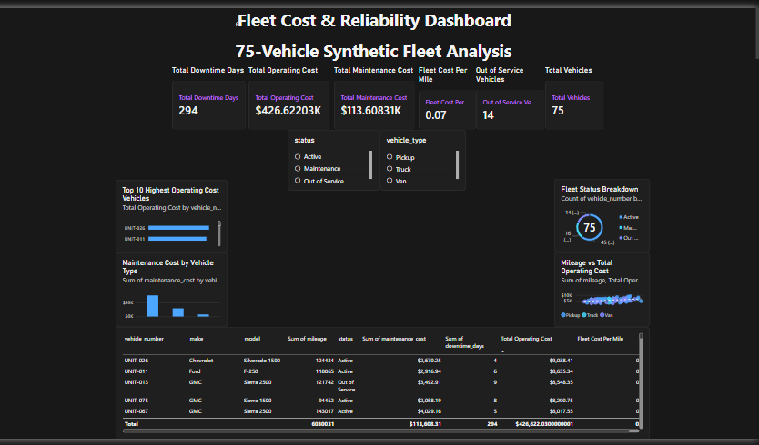
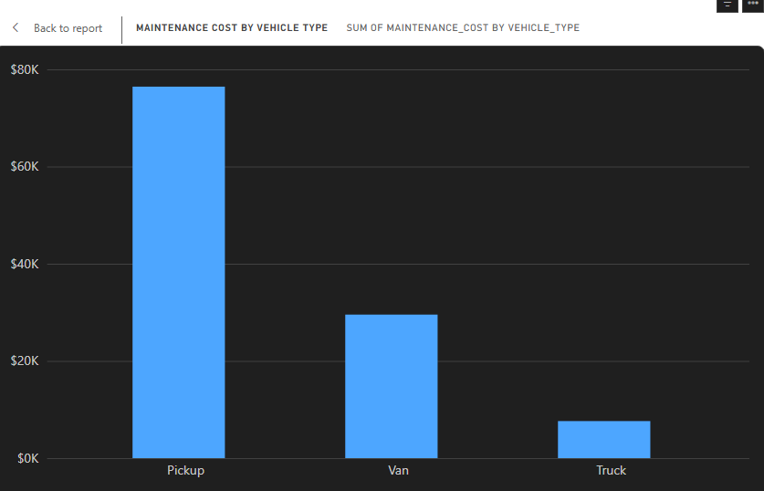
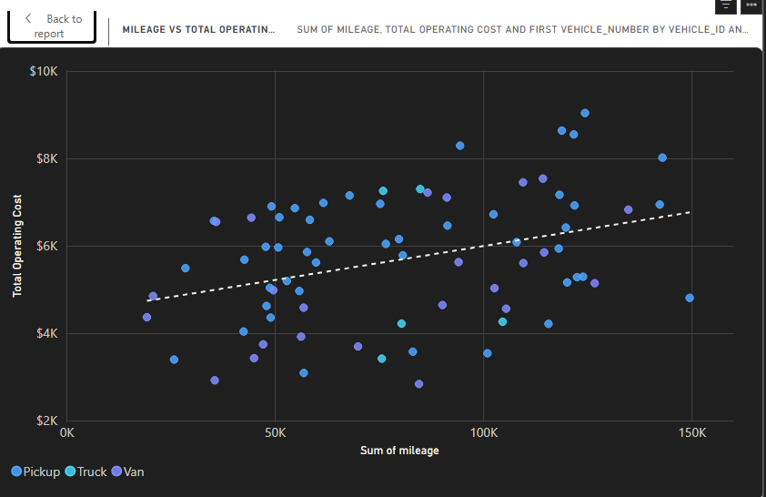
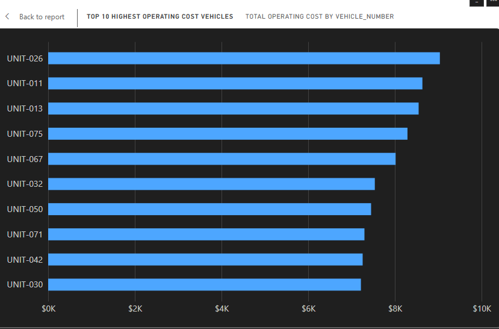

# Fleet Cost & Reliability Analytics

## Problem

Fleet and operations managers need a clear way to identify high-cost vehicles, understand where maintenance spending is concentrated, and see how mileage, downtime, and fleet status relate to operating cost.

The goal of this project was to build an interactive fleet management dashboard that turns vehicle-level data into a useful management view for identifying cost and reliability patterns and highlighting vehicles that may need further investigation.

## Data Source

This project uses a synthetic dataset representing 75 fleet vehicles. The data was generated specifically for analysis and portfolio development and does not contain actual employer or customer information.

The dataset includes vehicle characteristics and operating metrics such as year, make, model, vehicle type, mileage, fleet status, maintenance cost, repair count, downtime days, fuel usage, and fuel cost.

Additional analytics fields were created during data preparation, including vehicle age, total operating cost, and cost per mile.

## Dashboard Overview

## Method

The project was completed in several stages:

1. Generated a synthetic fleet dataset containing 75 vehicles for portfolio analysis.
2. Used Python to prepare an analytics-ready dataset and create calculated fields such as vehicle age, total operating cost, and cost per mile.
3. Imported the prepared CSV into Power BI Desktop and used Power Query to verify data types and prepare the model for reporting.
4. Created DAX measures for key management metrics, including total vehicles, total operating cost, total maintenance cost, total downtime days, fleet cost per mile, total repairs, and out-of-service vehicles.
5. Built an interactive Power BI dashboard using KPI cards, bar and column charts, a donut chart, a mileage-versus-cost scatter plot, and a detailed vehicle table.
6. Added Status and Vehicle Type slicers and configured visual interactions so managers can filter the dashboard while keeping useful fleet-wide context visible.
7. Tested the dashboard filters, calculations, and visual interactions to confirm the results behaved as expected.

## Findings

The dashboard highlighted several useful patterns in the synthetic fleet data:

1. **Pickup trucks had the highest average maintenance cost by vehicle type.**  
   This suggests that vehicle type can have a meaningful impact on maintenance spending and may be worth monitoring separately when comparing fleet costs.

2. **Total operating cost generally increased as vehicle mileage increased.**  
   The scatter plot showed an overall upward trend between mileage and operating cost. This indicates a relationship in the dataset, but it does not by itself prove that higher mileage causes higher operating cost.

3. **UNIT-026 had the highest total operating cost at approximately $9,038.41.**  
   The dashboard made it easy to identify individual high-cost vehicles that could be reviewed further for maintenance history, repair activity, mileage, downtime, and fuel expense.

The interactive slicers also allow the analysis to be narrowed by fleet status and vehicle type, making it easier to compare specific groups of vehicles and investigate potential cost or reliability issues.

## Business Decisions Supported

### 1. Prioritize Pickup Maintenance Review

Pickup trucks showed the highest average maintenance cost in the synthetic fleet. A fleet manager could use this information to review maintenance patterns, repair frequency, vehicle age, and replacement timing for pickups before making budgeting or replacement decisions.

### 2. Monitor Higher-Mileage Vehicles More Closely

The dashboard showed a general upward relationship between mileage and total operating cost. A manager could use mileage as one factor when deciding which vehicles should receive closer maintenance review, cost monitoring, or replacement analysis.

### 3. Investigate High-Cost Individual Vehicles

UNIT-026 had the highest total operating cost in the dataset at approximately $9,038.41. A manager could use the dashboard to identify vehicles like this and review their maintenance cost, repair activity, downtime, mileage, and fuel expense before deciding whether continued operation is cost-effective.
